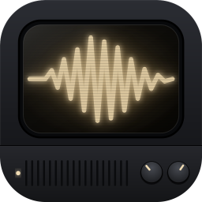

<p align="center"></p>

# Générateur de sujets — Sound design & composition

Un tirage de sujets d'exercice pour des étudiants de 3ᵉ année en sound design.
Une seule page HTML, sans installation, sans connexion : elle marche sur Mac, Windows, Linux, depuis une clé USB, un mail ou l'ENT.

- **[index.html](index.html)** — le générateur (à ouvrir dans un navigateur)
- **[BANQUE.md](BANQUE.md)** — tous les sujets, contraintes, intentions et familles, lisibles d'un coup

## Ouvrir

**Sur Mac** : télécharge le dépôt (bouton *Code → Download ZIP*, ou `git clone`), décompresse, puis double-clique sur `index.html`. Safari, Chrome ou Firefox conviennent. Si macOS demande une confirmation la première fois, clic droit → *Ouvrir*.

**En classe, sans rien distribuer** : le générateur est en ligne à l’adresse **<https://theovoneuw-cell.github.io/sujets-sound-design/>** (GitHub Pages, mis à jour automatiquement à chaque push sur `main`). Les étudiants l’ouvrent sur leur propre machine, sans rien télécharger.

Toute la page est un téléviseur cathodique : réglages à gauche, sujet diffusé à droite, chrono et réglages d'image sur la façade du bas. Tout tient en une seule vue sur ordinateur ; sur téléphone, tout s'empile.

## Utiliser

| Réglage | Options |
|---|---|
| **Travail** | Sound design seul · Composition seule · Compo + sound design |
| **Niveau** | Au hasard · 1 Fondamentaux · 2 Confirmé · 3 Expert (= nombre de contraintes) |
| **Durée** | Au hasard · Court 20-40 s · Moyen 1-2 min · Long 3 min + |
| **Pour qui** | Seul · Famille (une carte par participant, consigne commune) · Classe (un sujet différent par étudiant), avec ◂ ▸ pour le nombre |
| **Dans le sujet** | Intention · Contraintes (à allumer / éteindre) · Banque… |

Puis **Tirer un sujet** (ou la barre d'espace).

### Ce que contient un sujet

| Bloc | Rôle |
|---|---|
| **La scène** / **La commande** | Ce qu'il se passe, ce qu'on demande. Une à deux phrases. |
| **Ce qui doit s'entendre** | Le critère de réussite, vérifiable à l'écoute. C'est là-dessus que le rendu est évalué. |
| **Intention** | Le ton demandé, tiré séparément de la scène : les associations inattendues sont voulues. |
| **Contraintes techniques** | 1 en niveau 1, 2 en niveau 2, 3 en niveau 3. Deux contraintes contradictoires ne tombent jamais ensemble (deux tempos, synthèse + Foley…). |
| **Rendu** | Durée, format (WAV 48 kHz / 24 bits) et nom de fichier attendu : `RÉF_NOM.wav`. |

Chaque sujet porte une référence (`SD-042`, `CO-017`, `MX-078`, `FA-012` pour les familles) : pratique pour dire « refais-moi le SD-042 » ou pour nommer un rendu.

### Décocher, retirer, ajouter

- **Dans un sujet tiré** : chaque intention et chaque contrainte a sa case. Décochée, elle est barrée et disparaît du texte copié et de la feuille imprimée. Le ↻ au bout de la ligne en tire une autre à la place ; « + ajouter » ajoute une contrainte compatible ; sous l'écran, **↻ Intention** et **↻ Contraintes** retirent tout sans changer la scène.
- **Dans le menu** : « Intention » et « Contraintes » s'éteignent pour les retirer entièrement du sujet.
- **Banque…** : liste complète des contraintes et intentions. Une case décochée ne tombe plus au tirage. Le réglage reste dans le navigateur.

### Famille et classe

- **Famille** : un thème commun (les couleurs, la ville à 3 h du matin…), une carte différente par participant. 16 familles ont au moins 13 cartes, le maximum est 16.
- **Classe** : un sujet différent pour chaque étudiant (jusqu'à 40), en liste dans l'écran (chaîne 05). Chaque fiche se décoche, se retire (« ↻ Autre sujet ») ou s'agrandit pour la projeter ; ◂ ▸ ou les flèches du clavier passent d'un étudiant à l'autre, Échap revient à la liste.
- **Prénoms** (lien à côté du nombre) : facultatifs, un par ligne. Le nombre de participants suit la liste et chaque fiche porte le prénom. Ils restent dans le navigateur, rien n'est envoyé.

### Sujet du jour

Donne le **même tirage à tout le monde** pour une date et des réglages donnés. Il change tout seul le lendemain et ne consomme pas la banque.

### Pas de répétition

Les sujets tirés sont mémorisés par le navigateur et ne reviennent qu'une fois tous ceux du filtre épuisés. Le compteur en bas à gauche indique la réserve et combien ont déjà été tirés ; le lien en dessous remet l'historique à zéro.

### Façade du poste

| | |
|---|---|
| **Chrono** | 15 min à 3 h. Trois bips à la fin, puis il passe en négatif pour montrer le dépassement. Il s'affiche aussi en bas à droite de l'écran. Une contrainte « temps limité » le règle toute seule. |
| **Phosphore** | Ambre / vert / blanc — retinte toute l'interface. |
| **Balayage** | Coupe les lignes de balayage si elles gênent la lecture (vidéoprojecteur, écran fatigué). |
| **Écran** (touche P) | Plein écran, pour le vidéoprojecteur. |

Les réglages de la façade restent en mémoire d'une séance à l'autre.

**Copier** met le sujet (ou toute la classe) en texte brut dans le presse-papier. **Imprimer** ne sort que les sujets, en noir sur blanc, avec un cartouche nom / date.

## Logo et icône pour le bureau du Mac

Le dossier [logo/](logo/) contient le logo en SVG, en PNG (16 à 1024 px) et en **`SujetsSoundDesign.icns`**, l’icône macOS.

Pour avoir le générateur sur le bureau avec cette icône :

1. Dans Safari, ouvre <https://theovoneuw-cell.github.io/sujets-sound-design/> et glisse l’adresse (le petit cadenas / l’icône à gauche de l’URL) sur le bureau : un raccourci `.webloc` est créé.
2. Ouvre `logo/SujetsSoundDesign.icns` dans Aperçu, ⌘A puis ⌘C.
3. Sélectionne le raccourci sur le bureau, ⌘I (Lire les informations), clique sur la petite icône en haut à gauche de la fenêtre, puis ⌘V.

Variante « application » : dans Safari, *Fichier → Ajouter au Dock* crée une vraie app dans le Dock (macOS Sonoma ou plus récent) ; on lui change l’icône de la même façon (⌘I sur l’app dans ~/Applications).

Pour régénérer les icônes après une modification du SVG : rends `logo/logo.svg` en PNG 1024×1024 (n’importe quel navigateur ou outil), puis `node outils/fabriquer-icones.js rendu.png`.

## Contenu de la banque

| | |
|---|---|
| Sound design seul | 110 sujets |
| Composition seule | 101 sujets |
| Compo + sound design | 106 sujets |
| **Total** | **317 sujets** × 42 intentions × 57 contraintes, + 38 exercices de famille |

Chaque combinaison niveau × durée de chaque mode contient au moins trois sujets.

## Modifier la banque

Tout le contenu est en clair en haut du bloc `<script>` de `index.html`. Après modification, relance `node outils/exporter-banque.js` pour régénérer `BANQUE.md`.

Un sujet :

```js
{t:"La scène : ce qu'il se passe, en une à deux phrases.",
 e:"Ce qui doit s'entendre : le critère de réussite, vérifiable à l'écoute.",d:2,l:2},
```

- `t` — la scène (sound design, mix) ou la commande (composition). Vise 130 caractères maximum pour rester lisible à l'écran.
- `e` — l'enjeu. Une phrase, concrète, que l'on peut vérifier en écoutant le rendu. Vise 150 caractères maximum.
- `d` — niveau : `1` fondamentaux, `2` confirmé, `3` expert. Fixe le nombre de contraintes.
- `l` — durée : `1` court, `2` moyen, `3` long.

Ajoute-le dans le bon tableau : `sd`, `compo` ou `mix`. Ne supprime pas la virgule finale. Les références (`SD-042`…) suivent l'ordre du tableau : ajouter en fin de tableau évite de renuméroter les sujets existants.

Une contrainte :

```js
{t:"Le texte de la contrainte.",min:2},
```

`min` = niveau à partir duquel elle peut tomber (`2` = jamais en niveau 1). Facultatif : `k` (une clé) et `x` (les clés incompatibles) pour que deux contraintes contradictoires ne tombent jamais ensemble, `chrono:45` pour régler le chrono quand elle tombe. `CONS.common` = tous les modes, `CONS.sd` = sound design, `CONS.compo` = composition.

Une intention : une simple ligne de texte entre guillemets dans `INTENTIONS`.

Une famille (exercice de groupe) :

```js
{t:"Le nom de la famille", c:"La consigne commune.", m:["Carte 1","Carte 2","Carte 3"]},
```

Le nombre de cartes fixe la taille maximale du groupe pour cette famille.

Garde au moins un sujet dans chaque combinaison niveau × durée de chaque mode, sinon ce réglage affichera « Rien ne correspond ».
